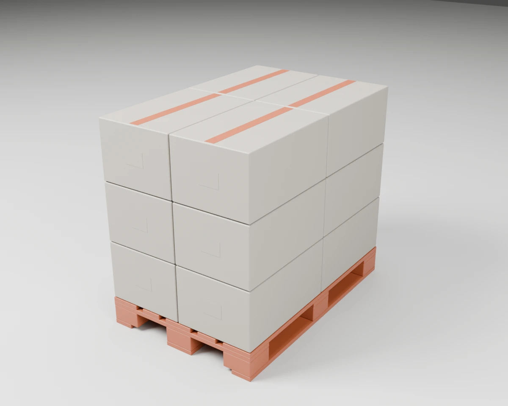
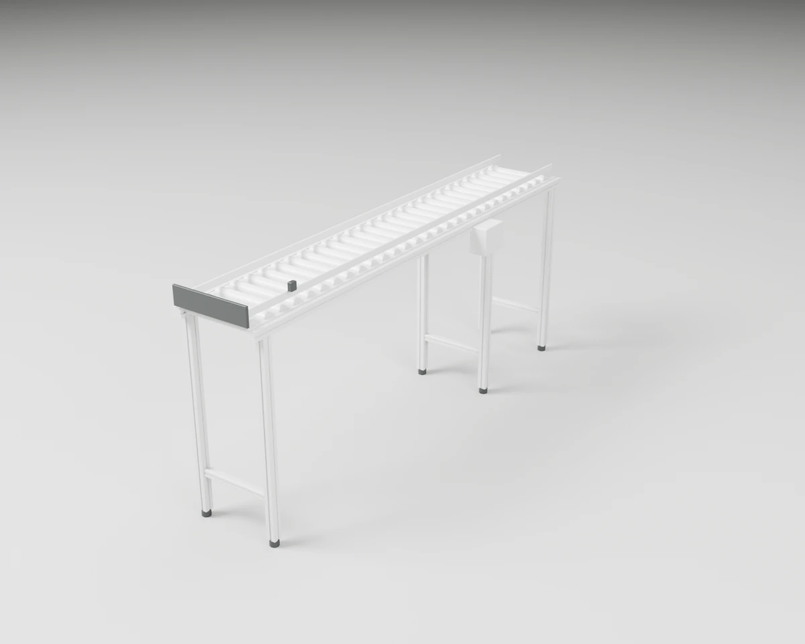

# Material Handling

Pallet trucks, tipping skips and other equipment for moving loads around a warehouse.

5 objects. Each folder holds `model.blend`, `model.urdf`, `assets/*.glb`, the model's `README.md` and `NOTICE.md`, and two renders (`renders/rest.webp` closed, `renders/open.webp` with the moving parts open).

| Closed | Open | Object | Size W × D × H (cm) | Moving joints | Interaction frames |
| --- | --- | --- | --- | --- | --- |
|  |  | **[#144 Hand Pallet Truck](./144-hand_pallet_truck/)** Manual pallet truck: pumping the drawbar lifts the forks, a lever on the handle releases them, and steering wheels and load rollers roll. | 54 × 142 × 123 | 1× slides, 2× hinges, 4× spins/rolls | 4 |
|  |  | **[#145 Tipping Skip on Castors](./145-tipping_skip/)** Steel tipping skip in a castor-mounted cradle with fork pockets; pulling the release lever lets the hopper roll forward and tip. | 91 × 128 × 94 | 2× hinges, 4× spins/rolls | 5 |
|  |  | **[#154 Robot Charging Dock](./154-charging_dock/)** Wall-standing charging dock for a mobile robot with two spring-loaded contact pads behind a floor plate. | 40 × 14 × 32 | 2× slides | 3 |
|  |  | **[#163 Palletised Carton Load](./163-palletised_carton_load/)** Flat 1200 x 800 block pallet carrying three layers of taped 600 x 400 cartons, as stored in pallet racking. | 80 × 120 × 104 | none | 4 |
|  |  | **[#166 Roller Conveyor with End Stop](./166-roller_conveyor_end_stop/)** Straight roller conveyor at bench height on aluminium-profile legs, with side guides, an end stop and a photo-eye at the pick end and a side-mounted drive box. | 45 × 215 × 98 | none | 3 |

[← All categories](../)
