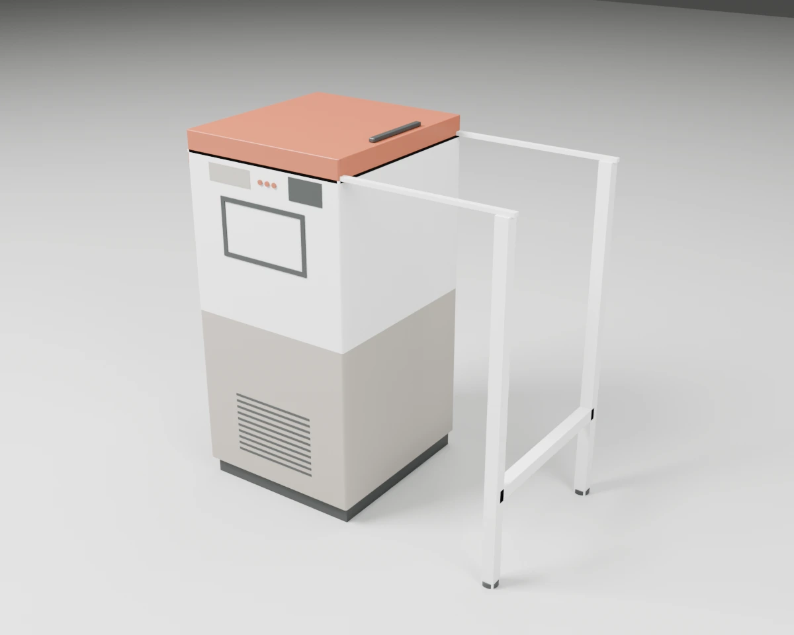
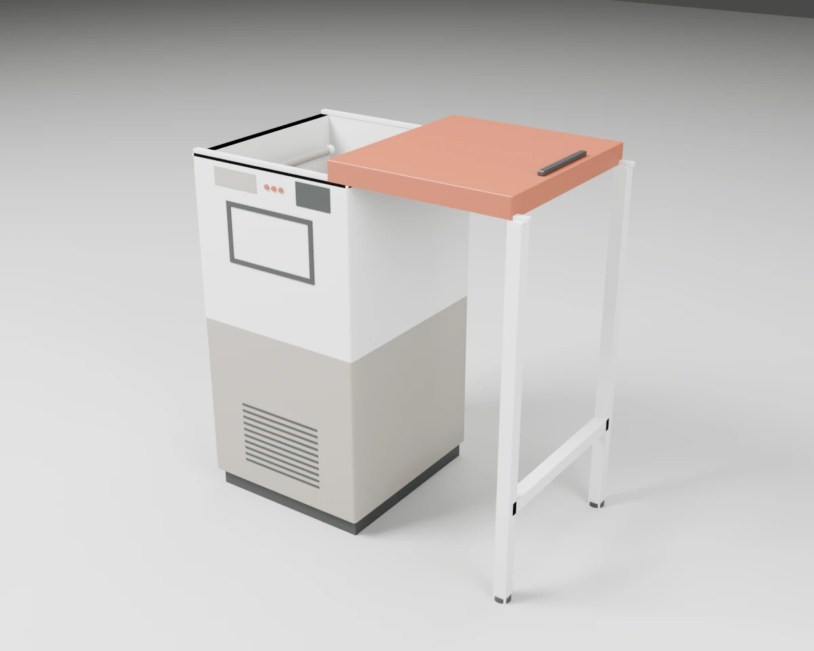
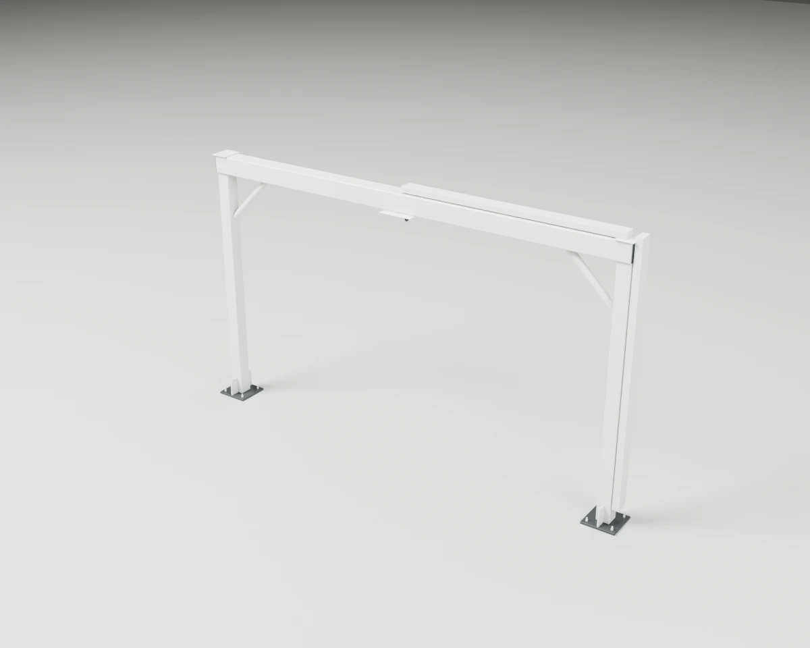
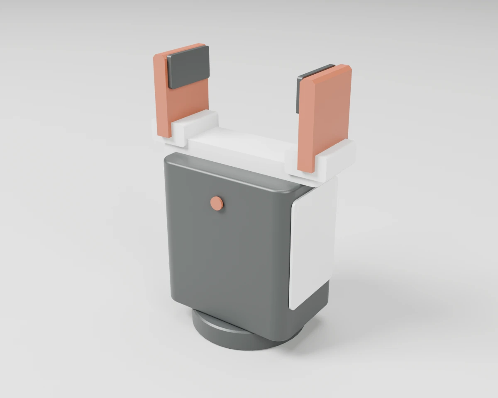
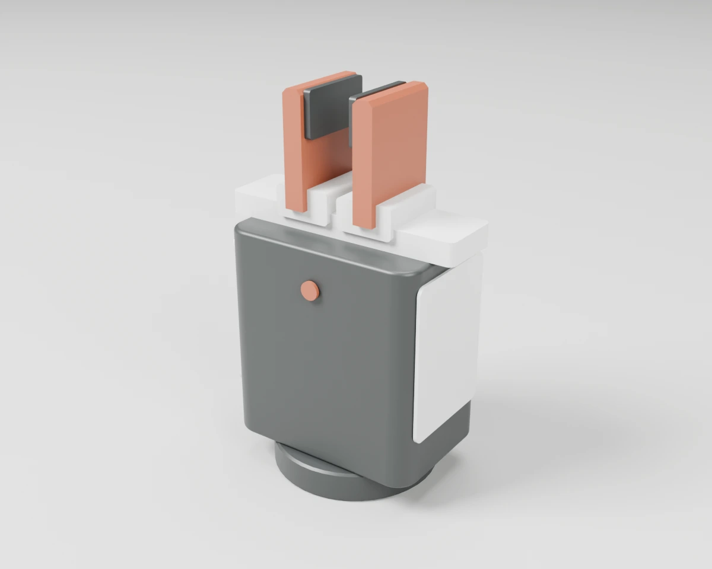

# Robot Cell Equipment

Robot portals, grippers, AMR top modules and process stations that automated cells are built from.

3 objects. Each folder holds `model.blend`, `model.urdf`, `assets/*.glb`, the model's `README.md` and `NOTICE.md`, and two renders (`renders/rest.webp` closed, `renders/open.webp` with the moving parts open).

| Closed | Open | Object | Size W × D × H (cm) | Moving joints | Interaction frames |
| --- | --- | --- | --- | --- | --- |
|  |  | **[#164 UV-C Tote Chamber with Sliding Lid](./164-uvc_tote_chamber/)** Top-loading UV-C chamber for one robot tote: a quartz shelf with corner guides, lamps below, beside and in the lid, and a lid that slides sideways onto two posts. | 113 × 64 × 120 | 1× slides | 5 |
|  |  | **[#165 Overhead Robot Portal](./165-overhead_robot_portal/)** Free-standing steel portal of two columns and a box-section beam with knee braces, a robot interface plate under the beam centre and a cable tray to one column. | 420 × 30 × 244 | none | 3 |
|  |  | **[#168 Parallel Gripper with Tote Fingers](./168-parallel_tote_gripper/)** Electric two-finger parallel gripper with long flat fingers and rubber pads that pinch a tote's rail from above; each finger closes 41.5 mm. | 12 × 8 × 17 | 2× slides | 2 |

[← All categories](../)
